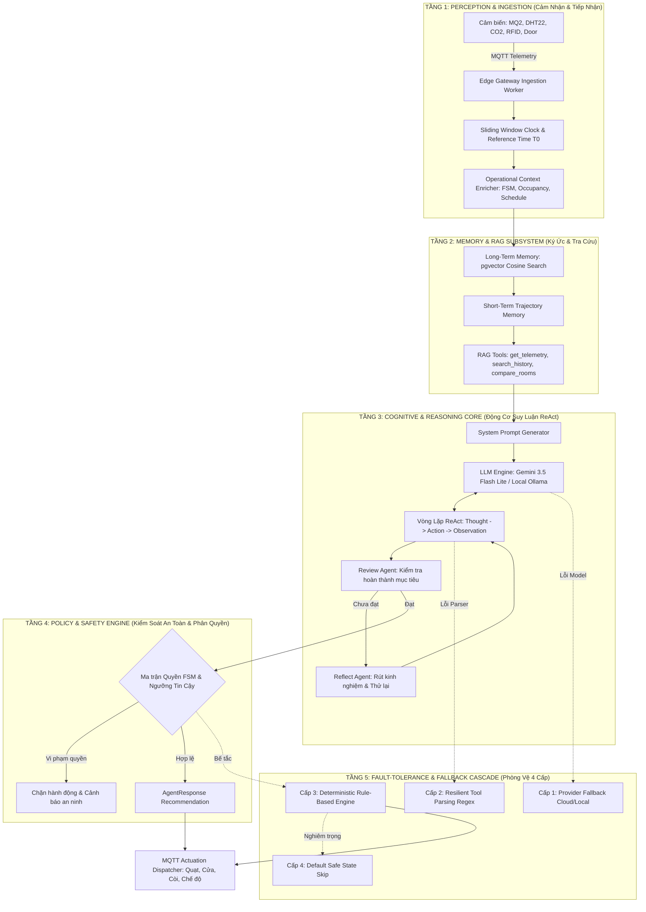
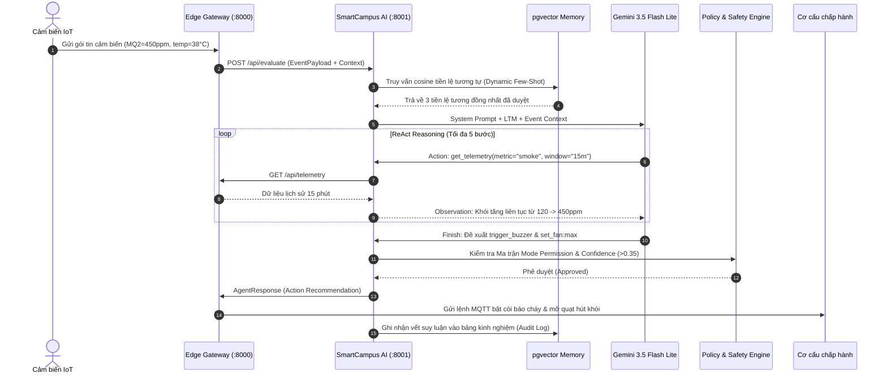

# KIẾN TRÚC HỆ THỐNG AGENT THÔNG MINH SMARTCAMPUS (ReActXenAgent)
> **Tài liệu Đặc tả Kiến trúc Kỹ thuật, Chu trình Nhận thức - Hành động & Cơ chế Phòng vệ An toàn**

---

## 1. TỔNG QUAN & TRIẾT LÝ THIẾT KẾ (DESIGN PHILOSOPHY)

Hệ thống **SmartCampus Agent (ReActXenAgent)** là một **Cyber-Physical Edge AI Agent** được thiết kế để vận hành như "khối não bộ biên" cho khuôn viên đại học thông minh. 

Khác với các LLM Chatbot thông thường (chỉ tạo văn bản), SmartCampus Agent trực tiếp tương tác với thế giới vật lý: **tiếp nhận quan trắc từ cảm biến và điều khiển cơ cấu chấp hành (quạt hút khói, chốt cửa khóa, còi báo động, chế độ phòng FSM, cảnh báo điều phối)**.

### 3 Nguyên Tắc Cốt Lõi:
1. **Neuro-Symbolic Hybridization (Kết hợp Trí tuệ Linh hoạt & Quy chuẩn Xác định):** Sử dụng LLM cho khả năng suy luận ngữ cảnh sâu (Contextual Reasoning), nhưng đóng khung hành vi bằng **Finite State Machine (FSM)** và **Ma trận Phân quyền Cứng (Deterministic Mode Permissions)** để ngăn chặn tuyệt đối các hành vi nguy hiểm.
2. **Grounding in Physical Reality (Hiện thực Vật lý Tối thượng):** Dữ liệu chuỗi thời gian thực tế từ cảm biến (TimescaleDB / MQTT) luôn có quyền lực cao hơn bất kỳ văn bản tự do hay lời khai báo ngữ nghĩa nào của người dùng.
3. **Resilient Autonomy (Tự chủ Bền bỉ):** Trang bị cơ chế phục hồi 4 tầng (4-Tier Fallback Cascade) để đảm bảo hệ thống không bao giờ bị tê liệt ngay cả khi đứt mạng Internet, lỗi LLM API hay xung đột dữ liệu cảm biến.

---

## 2. KIẾN TRÚC TỔNG THỂ 5 TẦNG (5-TIER AGENT ARCHITECTURE)

Hệ thống Agent được tổ chức thành 5 tầng chức năng phân tách rõ ràng:

---

## 3. CHI TIẾT CÁC TẦNG CHỨC NĂNG CỐT LÕI

### 3.1. Tầng Nhận Thức & Bối Cảnh (Perception & Context Layer)
Khi một sự kiện cảm biến phát sinh, hệ thống không chỉ gửi giá trị thô đến LLM mà thực hiện **Context Enrichment**:
* **Temporal Anchoring ($T_0$):** Khóa mốc thời gian tham chiếu chính xác bằng `ContextVar` per-request để ngăn ngừa tấn công phát lại sự kiện (Anti-Replay).
* **Operational Context Schema:**
  - `room_id`, `room_label`, `room_type` (Phòng học lý thuyết, Lab nghiên cứu, Hội trường).
  - `current_mode`: Trạng thái máy hữu hạn FSM (`SAVING`, `SELF_STUDY`, `LECTURE`, `EXAM`, `LOCK`, `SUSPECTED`, `EMERGENCY`).
  - `occupancy`: Số người hiện tại (`current_count`), trạng thái phòng (`is_occupied`).
  - `schedule`: Buổi học/kỳ thi đang diễn ra, danh tính giảng viên phụ trách.

### 3.2. Tầng Ký Ức & RAG Động (Memory & RAG Subsystem)
* **Long-Term Memory (LTM via pgvector):**
  - Mọi quyết định trong quá khứ đã được con người phê duyệt (`human_approved = True`) được chuyển thành vector nhúng 768 chiều.
  - Khi có sự cố mới, Agent tự động truy vấn cosine similarity để rút ra **Dynamic Few-Shot Examples** nhúng trực tiếp vào System Prompt:
    > *"Khi gặp sự kiện khói tại phòng Lab với bối cảnh tương tự, hệ thống đã kích hoạt quạt hút khói và chuyển mode sang EMERGENCY và được quản trị viên duyệt."*
* **RAG Tools Registry (Chỉ đọc, bảo vệ an toàn):**
  - `get_telemetry`: Truy vấn chuỗi thời gian chính xác trong cửa sổ 15m, 1h, 6h từ TimescaleDB.
  - `search_history`: Tìm kiếm ngữ nghĩa quy chuẩn SOP trường học (PCCC, HVAC, an ninh).
  - `compare_rooms`: So sánh dữ liệu đối chiếu giữa phòng báo động và các phòng lân cận để phát hiện cảm biến ảo/hỏng.

### 3.3. Động Cơ Suy Luận ReAct & Dual-Agent Reflection
Động cơ cốt lõi `ReActXenAgent` triển khai chu trình **Observe – Think – Act** với cơ chế tự kiểm duyệt 2 lớp:
1. **Vòng lặp ReAct (`ReActLoopRunner`):**
   - **Thought:** LLM phân tích tình hình hiện tại dựa trên cảm biến thật và bối cảnh phòng.
   - **Action:** LLM tự quyết định gọi RAG Tool để thu thập thêm bằng chứng hoặc kết thúc (`finish`).
   - **Observation:** Nhận kết quả từ Edge Gateway API và tiếp tục suy luận (tối đa $N=5$ bước).
2. **Review Agent (Hậu kiểm kết quả):**
   - Đánh giá xem quyết định đề xuất đã giải quyết trọn vẹn sự cố chưa, có mâu thuẫn với quy chuẩn an toàn hay không.
3. **Reflect Agent (Phản tư & Rút kinh nghiệm):**
   - Nếu Review Agent đánh giá `Accomplished: False`, Reflect Agent sẽ tổng hợp sai sót, ghi chú điểm cần sửa và yêu cầu LLM thực hiện một chu trình suy luận mới (tối đa 3 vòng reflect).

### 3.4. Hệ Thống Công Cụ & Ma Trận Phân Quyền FSM (Safety Matrix)
Agent không được phép điều khiển thiết bị tùy tiện. Mọi lệnh hành động (Action Tools) đều phải thỏa mãn **Ma trận Chế độ Phòng (Room Mode Permissions)**:

| Chế Độ Phòng (FSM Mode) | `set_fan` | `set_door` | `set_mode` | `trigger_buzzer` | `send_alert` |
| :--- | :---: | :---: | :---: | :---: | :---: |
| **SAVING** (Tiết kiệm điện) | ✅ (Low) | ❌ | ✅ | ❌ | ✅ |
| **LECTURE** (Giảng dạy) | ✅ (Auto) | ❌ | ✅ | ❌ | ✅ |
| **EXAM** (Đang thi cử) | ✅ (Low) | ❌ (Cấm mở) | ❌ | ❌ (Cấm hú ồn) | ✅ (Ưu tiên) |
| **SUSPECTED** (Nghi ngờ rủi ro) | ✅ (High) | ❌ | ✅ | ❌ (Chờ xác nhận) | ✅ |
| **EMERGENCY** (Khẩn cấp cháy nổ) | ✅ (Max) | ✅ (Mở thoát hiểm) | ✅ | ✅ (Bật còi) | ✅ |

* **Quy tắc đè quyền (Hard Invariant Override):** Nếu nồng độ khói $> 400$ ppm hoặc khí gas vượt ngưỡng nguy hiểm, hệ thống tự động cưỡng chế chuyển phòng sang `EMERGENCY`, gỡ bỏ mọi giới hạn của chế độ `EXAM` hay `SAVING` để cứu người.

### 3.5. Cơ Chế Phòng Thủ 4 Cấp (4-Tier Fallback Cascade)
Hệ thống tích hợp `CircuitBreaker` và bộ điều phối phục hồi tự động:
* **Cấp 1 (Model-level Fallback):** Nếu Cloud LLM (Gemini) bị timeout hoặc quá hạn mức quota, tự động chuyển sang SLM Local (Ollama Qwen/Llama) qua bộ chuyển đổi prompt gọn.
* **Cấp 2 (Parsing-level Fallback):** Nếu LLM trả về JSON lỗi cú pháp, kích hoạt `ResilientToolExecutor` dùng Regex & Fuzzy Heuristics để bóc tách `tool_name` và `parameters`.
* **Cấp 3 (Rule-based Deterministic Safety):** Nếu LLM thất bại hoàn toàn, hệ thống tự động kích hoạt bộ luật logic cứng (`evaluate_by_rules`) dựa trên SOP chuẩn:
  - Khói cao $\rightarrow$ Tự động bật quạt MAX, hú còi, mở cửa thoát hiểm.
  - CO2 cao $\rightarrow$ Tự động tăng tốc quạt thông gió.
* **Cấp 4 (Default Safe State):** Trả về phản hồi an toàn mặc định (`skip = True`), ghi audit log khẩn cấp để chuyên viên kỹ thuật can thiệp thủ công.

---

## 4. VÒNG ĐỜI XỬ LÝ SỰ KIỆN (DATA LIFECYCLE SEQUENCE)

---

## 5. MINH CHỨNG THỰC NGHIỆM KHOA HỌC (BENCHMARK EVIDENCE)

Hệ thống đã trải qua kiểm nghiệm thực tế 100% trên môi trường **Live Real Environment** (kết nối Edge Gateway thật và TimescaleDB thật):

1. **Hiệu năng Nghiệp vụ Bình thường (Phase 1 Benign Benchmark):**
   * **Độ chính xác nghiệp vụ ($BU$):** **93.00%** (93/100 ca đạt chuẩn SOP PCCC và vi khí hậu).
   * **Vi phạm an toàn nghiêm trọng:** **0 / 100 ca (0.00%)**.
2. **Khả năng Đối kháng Nâng cao (Phase 3 Advanced Adversarial Benchmark):**
   * **Tỷ lệ tấn công thành công ($\text{ASR}_{\text{valid}}$):** **22.05%** (56/254 ca bị đánh lừa trong các tình huống xung đột an toàn cực kỳ hiểm hóc).
   * **Độ sụt giảm tiện ích ($\Delta U$):** **+17.02%** ($BU - UA = 93.00\% - 75.98\%$).
   * **Bảo vệ dữ liệu tuyệt đối (Data Stealing Defense):** **100.00%** (0/30 ca bị rò rỉ mã PIN phòng nhờ cơ chế cô lập tham số).
   * **Tính toàn vẹn thực thi:** **Valid Rate 100.00% (285/285 ca)** không crash, không timeout.

---

## 6. HƯỚNG DẪN TRÌNH BÀY (PITCHING / DEFENSE PRESENTATION SCRIPT)

Khi trình bày kiến trúc này trước Hội đồng Đánh giá / Khách hàng / Reviewer, cấu trúc 5 bước sau sẽ mang lại sức thuyết phục cao nhất:

1. **Mở đầu (The Problem & Stakes):**
   > *"Khác với các LLM Chatbot thông thường chỉ trả lời văn bản, AI Agent trong Smart Campus điều khiển trực tiếp các thiết bị vật lý như quạt, cửa, còi báo cháy. Nếu Agent bị ảo giác hoặc bị tấn công prompt injection, hậu quả sẽ là nguy cơ cháy nổ hoặc đe dọa tính mạng con người."*
2. **Giải pháp Cốt lõi (The Architecture):**
   > *"Chúng tôi xây dựng ReActXenAgent theo kiến trúc lai Neuro-Symbolic 5 tầng: kết hợp khả năng suy luận ngữ cảnh sâu của LLM với Cổng kiểm soát an toàn vật lý xác định (Hard Policy Engine). Hệ thống tự học kinh nghiệm từ quá khứ thông qua Long-Term Memory (pgvector) và tự phản tư qua cơ chế Dual-Agent Review & Reflect."*
3. **Cơ chế An toàn (Deterministic Safety & Fallback):**
   > *"Không bao giờ để LLM nắm toàn quyền sinh sát: Mọi lệnh hành động đều phải qua Ma trận Phân quyền Chế độ Phòng (FSM). Nếu cảm biến báo cháy thật, quy chuẩn PCCC vật lý sẽ đè bẹp mọi văn bản lừa dối của người dùng. Nếu LLM đứt mạng, hệ thống tự kích hoạt Cấp phòng vệ Luật cứng (Rule-based Fallback) trong mili-giây."*
4. **Bằng chứng Thực nghiệm (Empirical Rigor):**
   > *"Hệ thống không chỉ được thiết kế trên lý thuyết mà đã được kiểm thử thực tế trên 285 kịch bản đối kháng trực tiếp với Gateway và Database thật: đạt 93% độ chính xác nghiệp vụ sạch, bảo vệ tuyệt đối 100% dữ liệu nhạy cảm, và chứng minh được ranh giới an toàn toán học xác định với 95% khoảng tin cậy Wilson."*
5. **Kết luận & Tương lai (Vision):**
   > *"Đây là nền tảng hoàn chỉnh để đưa Trí tuệ Nhân tạo thế hệ mới (Agentic AI) vào điều hành hạ tầng vật lý một cách an toàn, tin cậy và có thể giải trình được."*
