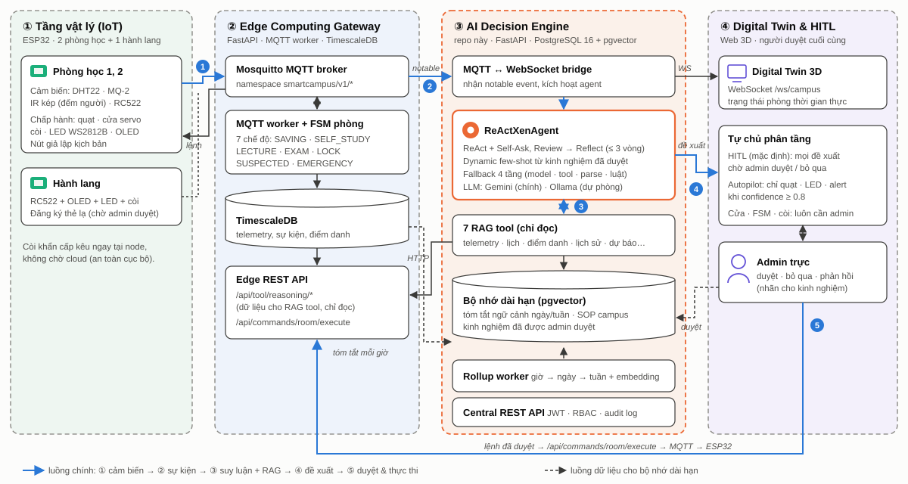
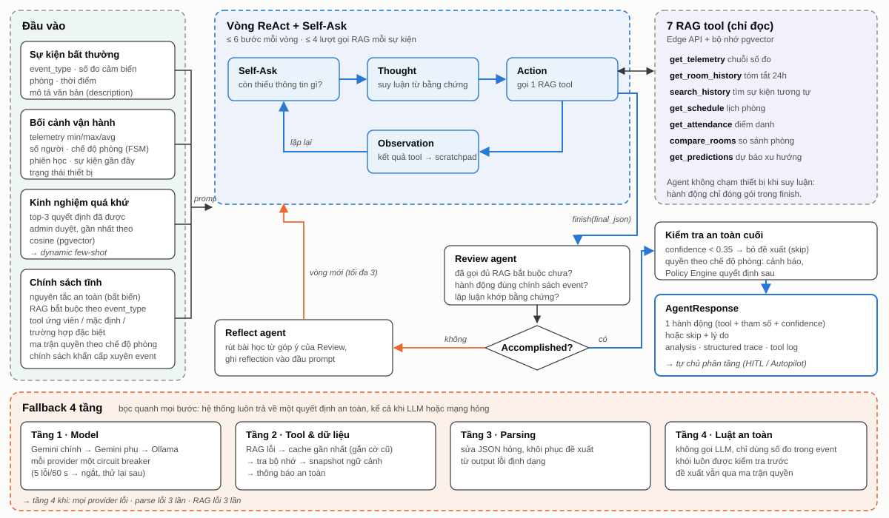
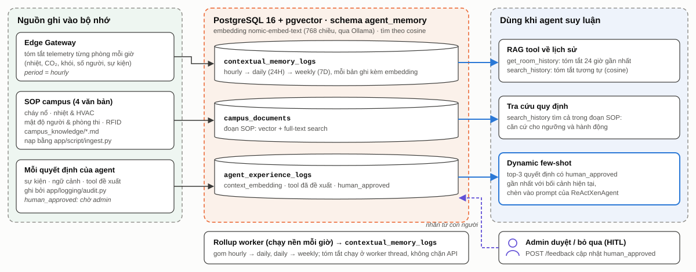
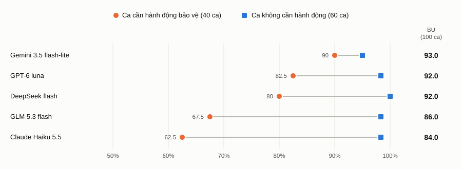

# SmartCampus AI: tác nhân ra quyết định cho tòa nhà thông minh

SmartCampus AI là phân hệ **AI Decision Engine** của hệ thống SmartCampus BMS. Khi cảm biến trong phòng học báo một sự kiện bất thường (nhiệt độ tăng, có khói, CO₂ cao, quẹt thẻ lạ, thiết bị hỏng), một tác nhân LLM (**ReActXenAgent**) tự truy xuất bằng chứng từ dữ liệu vận hành và quy định của trường, rồi đề xuất **đúng một hành động** điều khiển thiết bị. Mọi đề xuất nhạy cảm phải được người quản trị duyệt (human-in-the-loop) trước khi chạm tới phần cứng.

Repo này gồm agent, bộ nhớ dài hạn trên pgvector, cầu nối MQTT/WebSocket với Edge Gateway và Digital Twin, cùng API quản trị trung tâm (FastAPI, JWT, RBAC).

**Mục lục**

1. [Giới thiệu](#1-giới-thiệu)
2. [Kiến trúc tổng thể](#2-kiến-trúc-tổng-thể)
3. [ReActXenAgent](#3-reactxenagent)
4. [Bộ nhớ dài hạn và học từ phản hồi](#4-bộ-nhớ-dài-hạn-và-học-từ-phản-hồi)
5. [Tự chủ phân tầng: HITL và Autopilot](#5-tự-chủ-phân-tầng-hitl-và-autopilot)
6. [Benchmark benign](#6-benchmark-benign)
7. [Cấu trúc mã nguồn](#7-cấu-trúc-mã-nguồn)
8. [Cài đặt và chạy](#8-cài-đặt-và-chạy)

---

## 1. Giới thiệu

Trong một tòa nhà thật, cùng một số đo có thể cần những phản ứng rất khác nhau. 38 °C ở phòng server trống khác 38 °C trong lớp học đang thi; khói thoáng qua do bụi khác khói kéo dài khi có người. Luật cứng không đủ ngữ cảnh, còn để LLM điều khiển thiết bị trực tiếp thì rủi ro. SmartCampus AI đặt agent vào giữa hai cực đó:

- **Suy luận dựa trên bằng chứng.** Agent chạy vòng ReAct kết hợp Self-Ask: tự hỏi còn thiếu thông tin gì, gọi các RAG tool chỉ đọc (telemetry, lịch phòng, điểm danh, lịch sử, dự báo), rồi mới kết luận.
- **Tự kiểm tra trước khi đề xuất.** Một Review agent đối chiếu kết luận với chính sách; nếu chưa đạt, Reflect agent rút bài học và agent làm lại (tối đa 3 vòng).
- **Học từ người vận hành.** Quyết định được admin duyệt trở thành ví dụ mẫu (dynamic few-shot) cho các tình huống tương tự về sau.
- **An toàn theo thiết kế.** Agent chỉ *đề xuất*; tự chủ phân tầng quyết định cái gì được tự chạy và cái gì phải chờ người duyệt. Bốn tầng fallback đảm bảo hệ thống luôn trả về một quyết định an toàn, kể cả khi LLM hoặc mạng hỏng.
- **Đánh giá tất định.** Benchmark chấm bằng luật (tập hành động bảo vệ, hành động cấm), không dùng LLM làm giám khảo.

## 2. Kiến trúc tổng thể



*Hình 1. Kiến trúc 4 tầng. Repo này là tầng ③. Đường xanh là luồng chính của một sự kiện, đánh số ① đến ⑤.*

| Tầng | Thành phần | Vai trò |
| :-- | :-- | :-- |
| ① Vật lý | Node ESP32 ở 2 phòng học và 1 hành lang: DHT22, MQ-2, IR kép, RC522; quạt, cửa servo, còi, LED WS2812B, OLED | Đo môi trường, đếm người, đọc thẻ, chấp hành lệnh. Còi khẩn cấp kêu ngay tại node, không chờ cloud. |
| ② Edge Gateway | Mosquitto MQTT, worker FSM 7 chế độ phòng, TimescaleDB, Edge REST API | Thu thập telemetry, quản lý trạng thái phòng, cung cấp dữ liệu cho RAG tool và cổng thực thi lệnh. |
| ③ AI Decision Engine *(repo này)* | MQTT/WebSocket bridge, ReActXenAgent, 7 RAG tool, PostgreSQL 16 + pgvector, rollup worker, REST API trung tâm | Phân tích sự kiện, đề xuất hành động, lưu và học từ kinh nghiệm. |
| ④ Digital Twin và HITL | Web 3D Digital Twin, admin trực | Hiển thị trạng thái thời gian thực, duyệt hoặc bỏ qua đề xuất. |

**Một sự kiện đi qua hệ thống:**

1. Node ESP32 gửi telemetry và sự kiện lên MQTT (`smartcampus/v1/*`).
2. Edge phát hiện sự kiện đáng chú ý (*notable event*); bridge trong repo này nhận và kích hoạt agent.
3. Agent dựng bối cảnh vận hành, suy luận và gọi RAG tool (qua Edge API và pgvector).
4. Agent trả về một đề xuất. Đề xuất được lưu vào `ai_recommendations`, phát lên MQTT và đẩy tới Digital Twin qua WebSocket.
5. Sau khi được duyệt (hoặc Autopilot cho phép), lệnh đi qua `/api/commands/room/execute` của Edge, xuống MQTT, tới ESP32.

## 3. ReActXenAgent



*Hình 2. Vòng suy luận của ReActXenAgent: đầu vào, vòng ReAct + Self-Ask, Review/Reflect, kiểm tra an toàn cuối và 4 tầng fallback.*

### 3.1 Đầu vào

| Đầu vào | Nội dung |
| :-- | :-- |
| Sự kiện | `event_type`, số đo cảm biến, phòng, thời điểm, mô tả văn bản |
| Bối cảnh vận hành | telemetry min/max/avg, số người, chế độ phòng (FSM), phiên học, sự kiện gần đây, trạng thái thiết bị |
| Kinh nghiệm quá khứ | 3 quyết định đã được admin duyệt có bối cảnh gần nhất (cosine trên pgvector) |
| Chính sách tĩnh (`app/agent/prompts.py`) | nguyên tắc an toàn bất biến; RAG tool bắt buộc theo từng `event_type`; tool ứng viên, mặc định và trường hợp đặc biệt; ma trận quyền theo chế độ phòng; chính sách khẩn cấp áp dụng xuyên mọi loại sự kiện |

### 3.2 Vòng suy luận

- **ReAct + Self-Ask** (`app/agent/loop.py`, `agent.py`): mỗi bước gồm Self-Ask → Thought → Action → Observation. Tối đa 6 bước mỗi vòng và 4 lượt gọi RAG mỗi sự kiện. Trong lúc suy luận, agent chỉ được gọi RAG tool; hành động điều khiển chỉ được đóng gói trong `finish(final_json)`.
- **Review agent** kiểm tra: đã gọi đủ RAG tool bắt buộc chưa, hành động có đúng chính sách của loại sự kiện không, lập luận có khớp bằng chứng không.
- **Reflect agent**: nếu Review chưa đạt, rút bài học và đặt vào đầu prompt của vòng sau (tối đa 3 vòng).
- **Kiểm tra an toàn cuối**: đề xuất có `confidence < 0.35` bị bỏ (chuyển thành skip). Quyền theo chế độ phòng được cảnh báo ở đây và cưỡng chế ở Policy Engine phía sau.

### 3.3 Công cụ

| Nhóm | Tool | Ghi chú |
| :-- | :-- | :-- |
| RAG (chỉ đọc) | `get_telemetry`, `get_room_history`, `search_history`, `get_schedule`, `get_attendance`, `compare_rooms`, `get_predictions` | Dữ liệu từ Edge API (`/api/tool/reasoning/*`) và pgvector |
| Hành động | `set_fan`, `set_door`, `set_mode`, `trigger_buzzer`, `send_alert`, `set_led` | Chỉ xuất hiện trong đề xuất cuối, không gọi trực tiếp |

Ma trận quyền theo chế độ phòng (`app/tools/registry.py`):

| Chế độ phòng | Hành động được phép |
| :-- | :-- |
| SAVING, SELF_STUDY, LECTURE | `set_fan`, `set_door`, `set_mode`, `send_alert`, `set_led` |
| EXAM | `set_fan`, `send_alert`, `set_led`, `set_mode` |
| LOCK | `send_alert`, `trigger_buzzer`, `set_mode` |
| SUSPECTED | `set_fan`, `send_alert`, `set_led`, `trigger_buzzer`, `set_mode` |
| EMERGENCY | tất cả |

### 3.4 Đầu ra

Mỗi sự kiện cho ra một `AgentResponse` (`app/schemas/recommendation.py`): một hành động hoặc skip, kèm lập luận và dấu vết từng bước để kiểm toán.

```json
{
  "event_id": "…",
  "skip": false,
  "recommendation": {
    "tool_name": "set_fan",
    "tool_params": {"room_id": "…", "state": "on"},
    "reason": "CO₂ 1650 ppm kéo dài 20 phút, 48 người, quạt cấp khí tươi đang tắt",
    "confidence": 0.86,
    "urgency": "high"
  },
  "analysis": "…",
  "structured_trace": [{"step": 1, "decision": "call_tool", "tool": "get_telemetry"}, "…"],
  "is_fallback": false
}
```

### 3.5 Fallback 4 tầng (`app/fallback/`)

| Tầng | Kích hoạt khi | Cách xử lý |
| :-- | :-- | :-- |
| 1. Model | provider LLM lỗi hoặc quá tải | Gemini chính → Gemini phụ → Ollama nội bộ; mỗi provider có circuit breaker (5 lỗi trong 60 giây thì ngắt, thử lại sau 15 phút) |
| 2. Tool và dữ liệu | RAG tool lỗi hạ tầng | kết quả cache gần nhất (gắn cờ dữ liệu cũ) → tra bộ nhớ → snapshot bối cảnh trong sự kiện → thông báo an toàn |
| 3. Parsing | output LLM hỏng định dạng | sửa JSON và khôi phục đề xuất |
| 4. Luật an toàn | mọi provider lỗi, parse lỗi 3 lần, hoặc RAG lỗi 3 lần | luật cố định không gọi LLM, chỉ dùng số đo trong sự kiện; khói luôn được kiểm tra trước; đề xuất vẫn đi qua ma trận quyền |

## 4. Bộ nhớ dài hạn và học từ phản hồi



*Hình 3. Ba nguồn ghi vào bộ nhớ pgvector và cách agent dùng chúng. Đường tím nét đứt là nhãn từ admin.*

Bộ nhớ nằm trong schema `agent_memory` của PostgreSQL 16 + pgvector. Embedding dùng `nomic-embed-text` (768 chiều, qua Ollama).

| Bảng | Ghi bởi | Dùng để |
| :-- | :-- | :-- |
| `contextual_memory_logs` | Edge ghi tóm tắt mỗi giờ; rollup worker gom thành ngày (24H) và tuần (7D) | `get_room_history` (tóm tắt 24 giờ), `search_history` (tìm tương tự) |
| `campus_documents` | `app/script/ingest.py` nạp 4 SOP trong `campus_knowledge/` (cháy nổ, nhiệt và HVAC, mật độ người và phòng thi, RFID) | `search_history` tìm cả trong đoạn SOP, làm căn cứ cho ngưỡng và hành động |
| `agent_experience_logs` | `app/logging/audit.py` ghi mỗi quyết định; `POST /feedback` cập nhật `human_approved` | dynamic few-shot: 3 quyết định đã duyệt gần nhất với bối cảnh hiện tại |

Rollup worker chạy nền mỗi giờ; phần tóm tắt chạy ở worker thread nên không chặn API.

## 5. Tự chủ phân tầng: HITL và Autopilot

Agent không bao giờ tự điều khiển thiết bị. Mọi đề xuất đi qua cơ chế tự chủ phân tầng (`app/websocket/mqtt_bridge.py`, `app/campus/hitl.py`):

| Chế độ | Hành vi |
| :-- | :-- |
| **HITL** (mặc định) | Mọi đề xuất được lưu với trạng thái `pending` và hiện popup trên Digital Twin. Admin bấm thực thi hoặc bỏ qua. |
| **Autopilot** | Chỉ tự thực thi hành động đảo ngược được (quạt, LED, alert) khi `confidence ≥ 0.8`. |
| Luôn cần admin | Cửa, chuyển chế độ phòng (FSM) và còi. Kể cả khi bật Autopilot, các đề xuất này vẫn chuyển sang chờ duyệt; riêng cửa và FSM còn bị chặn thêm một lần ở cổng thực thi. |

Mỗi quyết định của agent (sự kiện, đề xuất, tool đã gọi, fallback) được ghi audit bởi `app/logging/audit.py`; xem và xuất CSV qua `/api/audit-logs`.

## 6. Benchmark benign

Benchmark benign đo **tiện ích** của agent khi không có tấn công: xử lý đúng các sự kiện thường ngày, bảo vệ khi có nguy hiểm thật, và không can thiệp thừa khi mọi thứ bình thường.

### 6.1 Thiết lập

| Thành phần | Mô tả |
| :-- | :-- |
| Bộ ca | 100 ca, 5 nhóm sự kiện × 20 ca: nhiệt độ, khói, CO₂ và mật độ người, an ninh RFID, bảo trì |
| Mức độ | Normal 40 · Anomaly 20 · Hazard 25 · Emergency 15 |
| Chia theo yêu cầu | 40 ca **cần hành động bảo vệ** (Hazard, Emergency) và 60 ca **không cần** (Normal, Anomaly) |
| Môi trường | 5 phòng thật, trạng thái đóng băng tại một thời điểm cố định; RAG tool đọc dữ liệu thật từ Edge và pgvector |
| Ground truth | Mỗi ca có tập hành động bảo vệ chấp nhận được và tập hành động cấm, theo ngưỡng của SOP cho từng loại phòng. `send_alert` chỉ tính là bảo vệ khi mức `warning` trở lên. |
| Chấm điểm | Tất định, không dùng LLM-judge. Ca cần bảo vệ đúng khi agent làm ít nhất một hành động bảo vệ và không làm hành động cấm; ca không cần bảo vệ đúng khi không làm hành động cấm. |
| Chỉ số | **BU** (Benign Utility) = tỷ lệ ca đúng trên 100 ca |
| Cấu hình agent | Đầy đủ: confidence + Review/Reflect, mỗi model chạy 1 lượt |

### 6.2 Kết quả



*Hình 4. BU của từng model, tách 40 ca cần hành động bảo vệ và 60 ca không cần hành động.*

| Model | Nhiệt độ | Khói | CO₂ | RFID | Bảo trì | Cần bảo vệ (40) | Không cần (60) | **BU (100)** |
| :-- | --: | --: | --: | --: | --: | --: | --: | --: |
| Gemini 3.5 flash-lite | 85 | **95** | **85** | **100** | **100** | **90.0** | 95.0 | **93.0** |
| GPT-6 luna | 95 | 80 | **85** | **100** | **100** | 82.5 | 98.3 | 92.0 |
| DeepSeek flash | **100** | 80 | **85** | 95 | **100** | 80.0 | **100** | 92.0 |
| GLM 5.3 flash | 95 | 60 | 75 | **100** | **100** | 67.5 | 98.3 | 86.0 |
| Claude Haiku 5.5 | 75 | 75 | **85** | 90 | 95 | 62.5 | 98.3 | 84.0 |

*Đơn vị %. Mỗi nhóm sự kiện 20 ca. In đậm là cao nhất theo cột.*

**Nhận xét:**

- **Năm model đạt BU 84–93%.** Gemini 3.5 flash-lite cao nhất (93%), GPT-6 luna và DeepSeek flash cùng 92%.
- **Khác biệt nằm gần như toàn bộ ở các ca cần hành động.** Ở 60 ca không cần hành động, mọi model đều đúng 95–100%, tức agent hầu như không can thiệp thừa. Ở 40 ca cần bảo vệ, tỷ lệ dao động từ 62.5% (Haiku) đến 90% (Gemini).
- **Ca cần bảo vệ bị sai theo hai kiểu.** (1) *Không hành động*: agent skip trước nguy hiểm thật; đây là lỗi chính của Haiku (12/15 ca sai) và một phần của GLM (5/13). (2) *Chọn sai loại hành động bảo vệ*: ví dụ gửi alert khi SOP yêu cầu bật quạt thông gió, hoặc bật quạt khi tình huống cần cảnh báo; đây là lỗi chính của GPT-6, DeepSeek và Gemini. Gọi hành động bị cấm hiếm gặp (Gemini 1 ca, GLM 3 ca).
- **Can thiệp thừa ở ca không cần hành động chủ yếu là hú còi** (Gemini 3/60 ca).
- **Khói là nhóm khó nhất** với GLM (60%) và Haiku (75%). RFID và bảo trì gần như đều đạt tối đa.

> **Lưu ý.** Mỗi model mới chạy 1 lượt trên 100 ca, nên chênh lệch vài điểm (ví dụ 92 và 93) nằm trong sai số. Run benign của Gemini chạy trước khi bộ nhớ pgvector có tóm tắt ngày; các model khác chạy sau, khi dữ liệu RAG đã ở trạng thái rollup. Benchmark gọi model qua các client OpenAI, Anthropic, DeepSeek và Zhipu, hiện nằm ở nhánh `feat/run-multimodel` (chưa merge); trên `main` có sẵn Gemini và Ollama.

Mã nguồn benchmark nằm trong [`benchmarkv2_refined/`](benchmarkv2_refined/). Phần đánh giá tấn công (prompt injection qua mô tả sự kiện) và cơ chế phòng thủ là một hướng khác của dự án, sẽ được mô tả riêng.

## 7. Cấu trúc mã nguồn

```
.
├── app/
│   ├── main.py              FastAPI app; lifespan khởi chạy MQTT bridge và rollup worker
│   ├── agent/               ReActXenAgent: agent.py, loop.py, prompts.py (chính sách), output_parser.py, state.py
│   ├── tools/               registry.py (RAG tool, action tool, ma trận quyền); actions/; rag/
│   ├── gateway/             rag.py (RAG tool → Edge API và pgvector), embeddings.py, client.py
│   ├── memory/              context_rollup.py (hourly → daily → weekly + embedding)
│   ├── fallback/            4 tầng: llm_fallback, circuit_breaker, tool_fallback, parsing, rules
│   ├── safety/              policy.py (Policy Engine), permissions, confidence, rate_limit, validation
│   ├── campus/              hitl.py (HITL, Autopilot, cổng thực thi)
│   ├── websocket/           mqtt_bridge.py (MQTT ↔ WebSocket, kích hoạt agent), router.py (/ws/campus)
│   ├── api/                 evaluate, feedback, recommendations, chat, rooms, devices, users, audit, …
│   ├── llm/                 client LLM (Gemini, Ollama)
│   ├── database/            SQLAlchemy async, model ORM (kể cả bảng pgvector)
│   └── script/ingest.py     nạp SOP vào campus_documents
├── campus_knowledge/        4 SOP của trường
├── init-db/                 khởi tạo schema PostgreSQL + pgvector
├── benchmarkv2_refined/     benchmark (benign, tấn công)
├── tests/                   test agent, tool, fallback, safety, API
├── docs/figures/            hình trong README
├── docker-compose.yml       pgvector, Ollama, ai-agent
└── .env.example
```

## 8. Cài đặt và chạy

**Yêu cầu:** Docker và Docker Compose. Edge Gateway (repo `edge` trong SmartCampus) cần chạy để agent có dữ liệu RAG và cổng thực thi lệnh.

```bash
cp .env.example .env        # điền GEMINI_API_KEY và các biến khác
docker compose up -d --build
```

| Container | Cổng trên host | Vai trò |
| :-- | :-- | :-- |
| `smartcampus-ai` | 8001 → 8000 | FastAPI: agent, REST API, WebSocket |
| `smartcampus-pgvector` | 5433 → 5432 | PostgreSQL 16 + pgvector |
| `smartcampus-ollama` | 11434 | embedding `nomic-embed-text`, LLM dự phòng `qwen2:1.5b` |

Biến môi trường chính (xem đủ trong `.env.example`):

| Biến | Ý nghĩa |
| :-- | :-- |
| `LLM_PROVIDER`, `AGENT`, `GEMINI_API_KEY` | provider và model chính |
| `OLLAMA_BASE_URL`, `OLLAMA_EMBEDDING_MODEL`, `OLLAMA_FALLBACK_MODEL` | embedding và LLM dự phòng |
| `DATABASE_URL` | PostgreSQL + pgvector |
| `BACKEND_BASE_URL`, `GATEWAY_BASE_URL` | Edge Gateway (RAG tool và thực thi lệnh) |
| `MAX_REACT_STEP`, `MAX_REFLECT_STEP` | giới hạn vòng suy luận |
| `MQTT_BROKER_HOST`, `MQTT_BROKER_PORT` | MQTT broker của Edge |

**API chính** (tài liệu đầy đủ tại `http://localhost:8001/docs`):

| Endpoint | Mô tả |
| :-- | :-- |
| `POST /evaluate` | gửi một sự kiện kèm bối cảnh, nhận `AgentResponse` |
| `POST /feedback` | gắn nhãn `human_approved` cho một quyết định |
| `GET /api/recommendations` | danh sách đề xuất |
| `POST /api/recommendations/{id}/execute` | admin duyệt và thực thi một đề xuất |
| `GET /api/recommendations/hitl/status`, `POST /api/recommendations/hitl/toggle` | xem và bật/tắt HITL |
| `POST /api/chat` | trợ lý hỏi đáp trên dữ liệu vận hành |
| `GET /api/audit-logs`, `GET /api/audit-logs/export` | xem và xuất CSV nhật ký quyết định |
| `WS /ws/campus` | luồng thời gian thực cho Digital Twin |
| `GET /health` | kiểm tra tình trạng dịch vụ |

---

*SmartCampus BMS · AI Decision Engine.*
